<!--
Perfil de sromansilva. Sube README.md y la carpeta assets/ a la raíz de
tu repositorio público sromansilva/sromansilva. Mantén las rutas relativas.
Las ilustraciones son originales y conceptuales; no son capturas de las apps.
La formación y habilidades proceden del texto de LinkedIn facilitado por Sergio.
Casa de Cambio se presenta como proyecto de equipo; no se incluye un enlace
al repositorio porque no es accesible públicamente al revisar esta versión.
-->

  

  

  <b>Convertir ideas en soluciones que tengan sentido para las personas.</b>

  
  

  <a href="#sobre-mí">Sobre mí</a> ·
  <a href="#proyectos-destacados">Proyectos</a> ·
  <a href="#tecnologías-y-herramientas">Tecnologías</a> ·
  <a href="#mi-actividad-en-github">Actividad</a>

## Sobre mí

Soy **Sergio Román Silva**, estudiante de **Ingeniería de Sistemas en el 9.º ciclo de la Universidad Tecnológica del Perú**. Me apasionan la tecnología, la innovación y las soluciones digitales que generan un impacto real en las personas.

Mi objetivo es aplicar el **desarrollo de software, el análisis de sistemas y la gestión de proyectos** para construir herramientas que combinen eficiencia, creatividad y valor humano. Me interesa conectar la parte técnica con interfaces claras y experiencias útiles.

Trabajo desde la colaboración, la comunicación y la organización. Disfruto resolver problemas, adaptarme a nuevos retos y seguir aprendiendo en cada proyecto.

  

## Proyectos destacados

### 01 · Casa de Cambio — Chapa Tu Cambio

Plataforma de cambio de divisas con experiencias para **cliente, operador y administrador**. Reúne cotizaciones, operaciones y gestión de cajas.

**Mi aporte:** diseño e implementación de las vistas del administrador, con funciones para monedas, tasas, cajas, movimientos y revisión de operaciones.

<code>React</code> <code>TypeScript</code> <code>Vite</code> <code>Interfaces por rol</code>

Proyecto desarrollado en equipo · Frontend de administración

### 02 · AshaKids Platform

Plataforma web para la **gestión y el apoyo de terapias de lenguaje infantiles**, con interfaces para las distintas personas que participan en la atención.

<code>React</code> <code>TypeScript</code> <code>FastAPI</code> <code>PostgreSQL</code>

**[Explorar ashakids-platform ↗](https://github.com/sromansilva/ashakids-platform)**

### 03 · LifeXperience

Plataforma **EdTech con aprendizaje gamificado**, misiones, niveles y seguimiento del progreso. Explora habilidades como comunicación, liderazgo, creatividad e inteligencia emocional.

<code>React</code> <code>TypeScript</code> <code>Supabase</code> <code>Motion</code>

**[Explorar LifeXperience ↗](https://github.com/sromansilva/LifeXperience)**

  
<b>Más proyectos de mi recorrido ↗</b>

| Proyecto | Enfoque | Código |
| :-- | :-- | :-- |
| **Intelligent Audit Dashboard** | Interfaz de un dashboard de auditoría con React y TypeScript. | [Softwaresunat](https://github.com/sromansilva/Softwaresunat) |
| **HabitMaster** | Diseño de una aplicación web de hábitos con componentes React y animaciones. | [habitmaster](https://github.com/sromansilva/habitmaster) |
| **UTP Lite React** | Proyecto web con React, JavaScript y Vite. | [utp-lite-react](https://github.com/sromansilva/utp-lite-react) |

## Tecnologías y herramientas

<b>Desarrollo web e interfaces</b>

  <picture>
    <source media="(prefers-color-scheme: light)" srcset="https://skillicons.dev/icons?i=react,ts,js,angular,vite,html,css,bootstrap&amp;theme=light&amp;perline=8" />
    
  </picture>

<b>Programación y datos</b>

  <picture>
    <source media="(prefers-color-scheme: light)" srcset="https://skillicons.dev/icons?i=java,nodejs,spring,mysql,postgres,supabase&amp;theme=light&amp;perline=6" />
    
  </picture>

<b>Diseño, colaboración y organización</b>

  <picture>
    <source media="(prefers-color-scheme: light)" srcset="https://skillicons.dev/icons?i=figma,notion,git,github&amp;theme=light&amp;perline=4" />
    
  </picture>

  
<b>Mi mapa de habilidades</b>

Los niveles son mi autoevaluación compartida en LinkedIn.

| Área | Intermedio | Elemental |
| :-- | :-- | :-- |
| Desarrollo | Java, JavaScript, Node.js, Spring Boot, HTML/CSS/Bootstrap, Angular, React | — |
| Datos | MySQL, SQL | PostgreSQL |
| Análisis y modelado | UML, Draw.io | Bizagi Modeler |
| Diseño | Figma | — |
| Gestión y colaboración | Notion | Trello, MS Project, Git/GitHub |

**Avanzado:** Canva, Word, Excel y PowerPoint.

**Aptitudes:** trabajo en equipo, liderazgo colaborativo, comunicación efectiva, orientación al cliente, resolución de problemas, adaptabilidad, organización y aprendizaje continuo.

## Mi actividad en GitHub

  <a href="https://github.com/sromansilva">
    <picture>
      <source media="(prefers-color-scheme: light)" srcset="https://github-readme-stats.vercel.app/api?username=sromansilva&amp;show_icons=true&amp;hide_rank=true&amp;hide_border=true&amp;card_width=500&amp;bg_color=FFFFFF&amp;title_color=7C3AED&amp;text_color=334155&amp;icon_color=0891B2&amp;locale=es&amp;custom_title=Mi%20GitHub" />
      
    </picture>
  </a>
  <a href="https://github.com/sromansilva?tab=repositories">
    <picture>
      <source media="(prefers-color-scheme: light)" srcset="https://github-readme-stats.vercel.app/api/top-langs/?username=sromansilva&amp;layout=compact&amp;langs_count=6&amp;hide_border=true&amp;bg_color=FFFFFF&amp;title_color=7C3AED&amp;text_color=334155&amp;locale=es&amp;custom_title=Lenguajes%20en%20mis%20repositorios" />
      
    </picture>
  </a>

  <a href="https://www.linkedin.com/in/sergio-roman-silva/"><b>Conversemos en LinkedIn ↗</b></a>

  

<!-- Recursos externos: https://github.com/DenverCoder1/readme-typing-svg,
https://github.com/tandpfun/skill-icons, https://shields.io/,
https://github.com/anuraghazra/github-readme-stats.
Las tarjetas de estadísticas dependen de esos servicios y de sus criterios de cálculo.
-->
